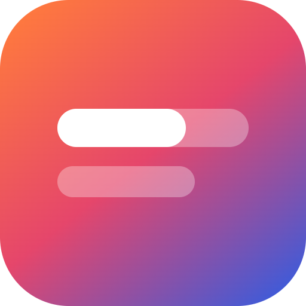
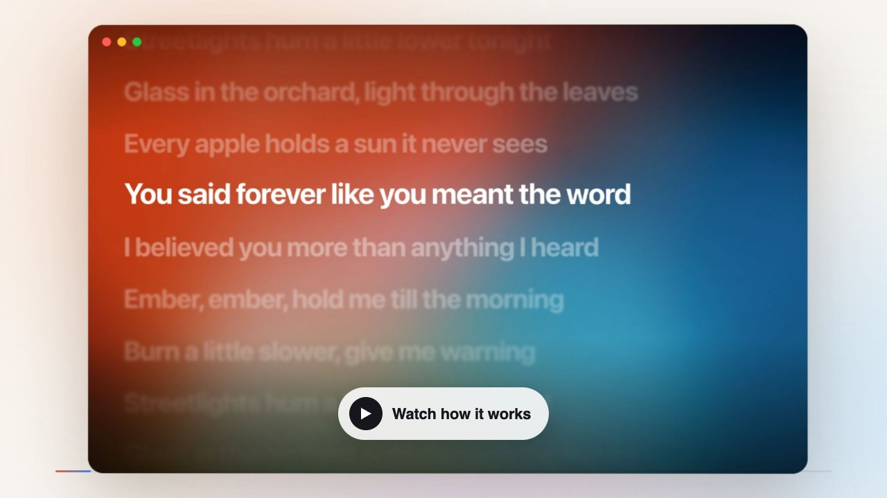

# Lyrique

Beautiful, time-synced lyrics for **Spotify, Apple Music and YouTube Music** on Mac and
Windows: word-by-word highlighting, full screen on a big display, a floating mini bar, romanization and translation, and lyrics
that line themselves up with the song.

Free and open source (GPL-3.0), with no account, no ads and no analytics. For macOS on Apple Silicon (M1 and later) and Intel Macs, and
Windows 10 and 11 ([Microsoft Store](https://apps.microsoft.com/detail/9P5TB3KSW5MT)).

[](https://lyrique.app/howto.mp4)

**Website and demo:** https://lyrique.app/

## Install

1. **Download** from the [latest release](https://github.com/Myo-Myint/lyrique/releases/latest):
   - `Lyrique-<version>-arm64.dmg` for Apple Silicon Macs (M1, M2, M3, M4 and later)
   - `Lyrique-<version>-x64.dmg` for Intel Macs

   Not sure which Mac you have? Apple menu → About This Mac: "Chip: Apple M…" means arm64,
   "Processor: … Intel" means x64.
2. Open the DMG and drag **Lyrique** into **Applications**.
3. **First launch only:** this early version isn't notarized by Apple yet, so macOS asks you
   to confirm it once:
   1. Open Lyrique from Applications. macOS says it can't verify the app — click **Done**.
   2. Open **System Settings → Privacy & Security**, scroll down to the Lyrique message, and
      click **Open Anyway**, then confirm.

   After that, Lyrique opens normally.
4. **Spotify or Apple Music:** nothing else to install. Play a song; the first time, macOS
   asks to let Lyrique see Spotify or Music — click **Allow**.
5. **YouTube Music:** add the browser extension
   [Lyrique Bridge from the Chrome Web Store](https://chromewebstore.google.com/detail/hagidkilfihkflpgpmnoifgbckldiikd).
   It works in **Chrome, Edge, Brave, Arc, Opera and Vivaldi**.

### Windows

**[Get Lyrique from the Microsoft Store](https://apps.microsoft.com/detail/9P5TB3KSW5MT)** (Windows 10 and 11). It installs in one
click, with no security warning, and the Store keeps it up to date. Spotify and Apple Music are
followed through Windows' own media controls, with nothing to set up. YouTube Music uses the
same browser extension as on the Mac.

**Direct download instead:** the installers are on the
[Windows release](https://github.com/Myo-Myint/lyrique/releases/tag/v0.6.3-beta.1):
`Lyrique-0.6.3-x64.exe` for almost every PC (Intel or AMD), `Lyrique-0.6.3-arm64.exe` for
Windows on Arm. They install just for you, with no admin rights needed. They aren't code-signed
yet, so if SmartScreen says "Windows protected your PC", click **More info → Run anyway**. See
the [code signing policy](https://lyrique.app/code-signing.html).

Lyrics appear as soon as a song plays. With several players open, Lyrique follows the one
that started playing most recently.

## Using it

| | |
|---|---|
| **Settings** (players, text, timing, where lyrics show) | **⌘,**, or the sliders button in the top bar |
| **Every keyboard shortcut** | **?**, or the ? button at the bottom right |
| **Play / pause, ±10 s, previous / next** | the buttons at the bottom of the window (move the mouse), or Space · ← / → · ⇧← / ⇧→ |
| **Full screen on another display** | menu-bar icon → *Show on Display*, then **F** |
| **Karaoke** (full screen, lyrics only, extra large) | **K** (Esc to leave), or menu-bar icon → *Karaoke Mode* |
| **Cover view** (artwork as the hero) | **C**, or click the artwork |
| **Mini lyrics bar** over every window | **M** in Lyrique, or **⌥⌘L** from anywhere |
| **Romanization / translation** under each line | **T** (translation language: menu-bar icon → *Lyrics* → *Translate To*) |
| **Text size** | **+** / **−** (or menu-bar icon → *Lyrics*) |
| **Font** (system, rounded, serif) | menu-bar icon → *Lyrics* |
| **Share a line** as an image | right-click the line, or **S** for the current one |
| **Wrong lyrics?** | ↻ in the top bar (or click the source name) to pick another version |
| **Lyrics in the menu bar** | menu-bar icon → *Lyrics in Menu Bar* |
| **Language** (English, Español, Français, Português, မြန်မာ, ไทย, 日本語, 한국어, 简体中文, 繁體中文) | follows your Mac; change it in Settings → *Language* |
| **What's new** after an update | shown once; reopen from the menu-bar icon → *What's New…* |
| **Calmer view** (still background, lines fade instead of slide) | Settings → *Reduce motion* (on automatically with macOS Reduce Motion) |
| **Choose which apps to follow** | menu-bar icon → *Follow* |
| **Lyrics timing off?** | − / + in the top bar nudges this song; ⌥ − / + adjusts for your headphones (e.g. AirPods) |
| **No lyrics?** | *Sync it yourself*: paste the words and tap Space as each line starts |

## Updates

Lyrique checks this repository's releases and tells you when a new version is out (menu-bar icon → *Update
Available*). Download it and replace the app in Applications. The Microsoft Store version
updates itself through the Store.

## Problems or ideas

[Open an issue](https://github.com/Myo-Myint/lyrique/issues/new/choose). For bugs, click the menu-bar icon → **Copy
Diagnostics** and paste it in: it lists the app and extension versions and which lyrics
sources were tried, which makes most problems quick to find. Anything else, or if you'd rather
not use GitHub: [hello@lyrique.app](mailto:hello@lyrique.app).

## Privacy

See [PRIVACY.md](PRIVACY.md). In short: nothing about your listening leaves your computer except
title/artist lookups to lyrics services (and Apple's catalogue, for Apple Music covers),
and lyric text to Google Translate only while
romanization or translation is switched on.

## How it works (for developers)

```
 Spotify / Apple Music                YouTube Music tab (Chrome, Edge, Brave, Arc…)
 macOS: AppleScript (osascript)       Lyrique Bridge extension
 Windows: system media controls       inject.js → content.js → background.js
            │                                      │ WebSocket, localhost only
            ▼                                      ▼
 ┌──────────────────────────────────────────────────────────────┐
 │ Lyrique (Electron)                                            │
 │ main: players, bridge, lyrics lookup + cache, tray, updates  │
 │ renderer: lyrics window, mini bar, settings, tap-to-sync     │
 └──────────────────────────────────────────────────────────────┘
```

- **Players.** On macOS, Spotify and Music are read with AppleScript a few times a second
  (`src/main/players.ts`). On Windows, a small PowerShell script reads the system media
  controls (SMTC) instead (`src/main/players-win.ts`). YouTube Music has no desktop API, so
  the browser extension in `extension/` reads the player in the tab and streams the track and
  position to the app over `127.0.0.1`.
- **Lyrics.** YouTube Music's own timed lyrics when the extension has them, then
  [LRCLIB](https://lrclib.net) (free and keyless, with word timings when available), then QQ
  Music, then plain text. Line-only lyrics get estimated word timings for the highlight
  (`src/shared/estimate.ts`). If nothing exists, you can sync a song yourself by tapping
  along, and optionally share it back to LRCLIB.
- **Nothing to configure, nothing collected.** There are no API keys in this repository, no
  analytics, and no Lyrique server. See the [privacy policy](PRIVACY.md).

## Develop

Needs Node.js 22+.

```bash
npm install
npm run dev        # app with hot reload
npm test           # unit tests (vitest)
npm run typecheck
```

For YouTube Music, install [Lyrique Bridge from the Chrome Web Store](https://chromewebstore.google.com/detail/hagidkilfihkflpgpmnoifgbckldiikd), or load
`extension/` as an unpacked extension (`chrome://extensions` → Developer mode → Load unpacked)
while working on it, and play something on music.youtube.com.

| Path | What's there |
|---|---|
| `src/main` | Electron main process: windows, tray, players, extension bridge, lyrics lookup, updates |
| `src/preload` | The `window.lyrique` API exposed to the renderer |
| `src/renderer` | Lyrics UI in plain TypeScript and CSS (no framework) |
| `src/shared` | LRC parsing, matching, word-timing estimates, romanization, translations (`locales/`) |
| `extension/` | The Lyrique Bridge browser extension (Manifest V3) |
| `tests/` | Unit tests |
| `scripts/` | Playwright scripts for smoke tests, screenshots and the site demo |
| `site/` | The website at lyrique.app, deployed by `.github/workflows/pages.yml` |
| `video/` | The how-to video (Remotion) |

## Build

```bash
npm run dist:release   # macOS: dmg + zip for arm64 and x64
npm run dist:win       # Windows: NSIS installers for x64 and arm64
```

Icons are drawn from one master, `build/icon.svg` (full-bleed, unmasked, as Apple's icon
guidelines ask). After changing it, run `node scripts/make-icons.mjs` (needs Google Chrome) to
regenerate the Mac and Windows app icons, the extension icons, the website icon and the menu
bar template icons.

Always build Windows installers with `dist:win`. It forces 7-Zip's BCJ filter, because the
installer's unpacker can't read the ARM64 filter that newer 7-Zip picks for arm64 binaries.

## Translations

UI strings live in `src/shared/locales/`, one file per language, and `tests/i18n.test.ts`
checks that every language has every key with matching placeholders. Corrections from native
speakers are very welcome.

## License

[GPL-3.0](LICENSE). Lyrics belong to their rights holders. Lyrique shows them from public
sources for personal use and doesn't ship any.
